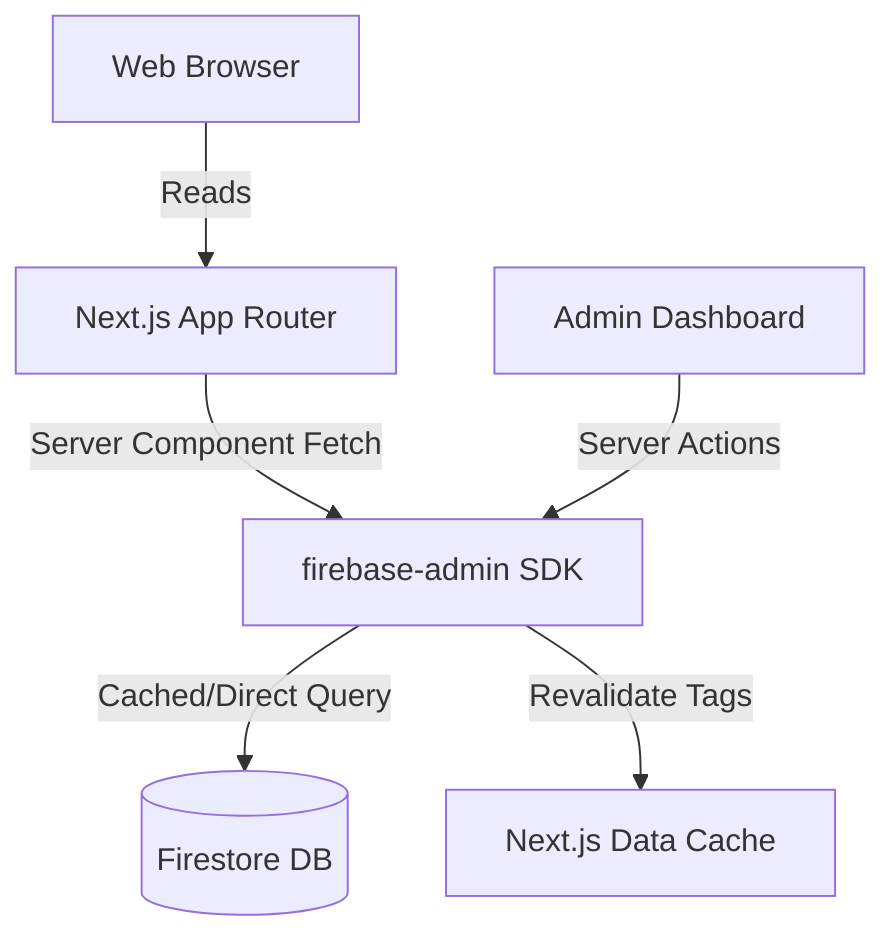

# Bilbili - Educational and Informative Blog Website

Bilbili is a high-performance, accessible, hierarchical educational blogging platform.

## Architecture & Data Flow

## Setup & Environment
Configure `.env.local` based on `.env.example`.

## Scripts
- `npm run dev`: Start Next.js dev server.
- `npm run build`: Production build.
- `npm run verify`: Run lint, typecheck, line-length check, codemap generator, and test suite.
